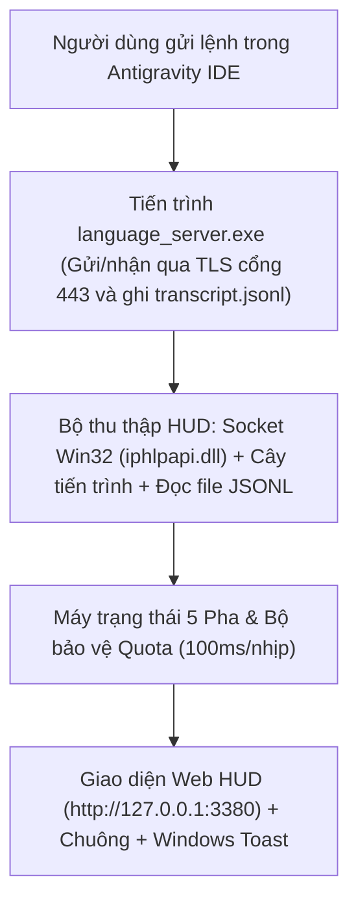

# Hướng Dẫn & Giải Thích Chức Năng Web `Cache & Latency HUD`

> [!abstract]+ Tóm tắt: Trang web này làm gì?
> **Cache & Latency HUD** (`http://127.0.0.1:3380`) là bảng điều khiển chạy ngầm trên máy bạn để làm **3 việc cốt lõi**:
> 1. **Đọc chính xác KV Cache & Quota thực tế:** Đối chiếu trực tiếp từng bước LLM xem bao nhiêu token được đọc lại từ bộ nhớ đệm trên Google TPU (`Cache Read` — rẻ/tiết kiệm) và bao nhiêu token phải nạp mới hoàn toàn (`Fresh Input` — đốt hạn mức quota).
> 2. **Theo dõi tiến độ từng pha của 1 Step theo thời gian thực (`10Hz / 100ms`):** Mổ xẻ rõ từng chặng `Tool Local` $\to$ `Gửi & First-Byte ACK / TTFB` $\to$ `TPU Thinking Stream` $\to$ `Đầu ra & Chốt sổ`.
> 3. **Phòng vệ chống rớt Cache ("Cây vàng") & Kiểm soát mạng:** Đếm ngược giới hạn giữ cache `5 phút` (`TTL 300s`), chẩn đoán mạng có đang bị nghẽn ngầm hay không, và phát cảnh báo / tạo bản tóm tắt cắt lỗ (`Smart Handoff`) trước khi bạn bị mất trắng hàng trăm nghìn token.

---

## 1. Luồng Hoạt Động Tổng Thể Của Hệ Thống

Tổng dung lượng ngữ cảnh mà Google TPU đang giữ cho phiên tại bước thứ $k$ là:

$$N_{\text{context}}(k) = N_{\text{cache\_read}}(k) + N_{\text{fresh\_input}}(k)$$

Mỗi khi bước sau giữ được KV Cache từ bước trước, `Fresh Input` chỉ tốn vài trăm đến vài nghìn token cho câu lệnh mới. Ngược lại, nếu bị rớt cache, toàn bộ $N_{\text{context}}(k)$ bị đẩy sang `Fresh Input` (tạo ra **Cây vàng**).

---

## 2. Giải Thích Thanh Điều Khiển Trên Cùng & Khung Tiến Trình 4 Pha

### 2.1. Thanh Header (Trên cùng)

> [!info]+ Ý nghĩa các huy hiệu & nút bấm ở góc trên
> - **`LIVE` (xanh lá) / `RECONNECTING` (đỏ):** Báo kết nối thời gian thực giữa trình duyệt và server Python có đang thông suốt hay đã tắt.
> - **`FULL KERNEL ESTATS` vs `STANDARD USER`:**
>   - `FULL KERNEL ESTATS` (chạy qua `run_hud_admin.bat`): Mở khóa bộ đếm tầng nhân Windows, đọc chính xác từng byte vào/ra, mốc `ACK`, độ trễ `RTT (ms)` và số gói tin rớt (`Retransmits`) trên từng socket `:443`.
>   - `STANDARD USER` (chạy qua `run_hud.bat`): Đọc đầy đủ 100% số token chuẩn, danh sách IP Google, tiến trình con và ước lượng lưu lượng qua I/O của tiến trình mà không cần quyền Admin.
> - **`RAM: XX MB`:** Mức bộ nhớ thực tế mà chính tiến trình HUD đang tiêu thụ.
> - **`Tiết kiệm: +X | Lũy kế: Y`:** Huy hiệu xanh lá đếm tổng số token đã tiết kiệm được từ lúc mở HUD (và tổng lũy kế nhiều lần mở lưu trong `hud_settings.json`).
> - **`Xuất JSON`:** Tải toàn bộ lịch sử token và độ trễ của phiên đang xem về máy dạng file `.json`.
> - **`Copy Handoff`:** Tự động gom mục tiêu, tệp vừa sửa và bước dở dang của phiên hiện tại thành một bản tóm tắt gọn (`~1.5k – 3k` token) rồi chép sẵn vào Clipboard.
> - **`Test Chuông`:** Bấm để thử ngay âm thanh cảnh báo trên trình duyệt kèm thông báo nổi Windows Toast.
> - **`Chuông: Bật` / `Chuông: Tắt`:** Bật hoặc tắt nhanh âm thanh cảnh báo.

### 2.2. Khung Tiến Trình Chu Trình 1 Step (4 ô nối tiếp)

Khung này luôn nằm ở phía trên để bạn biết ngay tại giây hiện tại Agent và server Google đang làm gì:

1. **`1. Tool Local`:** Sáng đèn khi Agent đang chạy lệnh trên máy bạn (`run_command`, `edit_file`, `write_file`, `read_file` hoặc tiến trình con như `powershell.exe`, `wsl.exe`, trình biên dịch).
2. **`2. Gửi & ACK / TTFB`:** Sáng đèn ngay sau khi lệnh local xong và dữ liệu được đẩy lên Google cổng `443`. Hiển thị xác nhận `ACK` đường lên và đếm thời gian chờ phản hồi đầu tiên từ TPU (`TTFB / Prefill`).
3. **`3. TPU Thinking Stream`:** Sáng đèn khi byte dữ liệu suy luận đầu tiên (`> 320` bytes, đã lọc nhiễu gói điều khiển HTTP/2) bắt đầu đổ từ Google về máy bạn.
4. **`4. Đầu ra & Chốt sổ`:** Nháy sáng khi `transcript.jsonl` ghi xong bước mới (`DONE`), chốt chính xác số token `Output` và reset đồng hồ `TTL 5 phút`.

> [!warning]+ Ý nghĩa khi Khung Tiến Trình tự đổi màu
> - **Khung Vàng:** Phiên đang vượt ngưỡng bảo vệ (`Auto-Guard`) và bộ nhớ đệm chỉ còn `<= 60 giây` trước khi hết hạn 5 phút.
> - **Khung Đỏ:** Xảy ra 1 trong 3 tình huống khẩn cấp:
>   1. Google TPU đang chờ/suy luận lâu **`> 90s`** (hiện rõ chẩn đoán xem mạng nhà có bị đứt hay TPU đang nghĩ thật).
>   2. Phát hiện dấu hiệu **đứt/nghẽn TCP cục bộ** (`NETWORK_STALL_SUSPECTED`).
>   3. **Cache đã hết hạn (`00:00`)** trên một phiên ngữ cảnh lớn — cảnh báo để bạn không gõ nhầm câu ngắn làm đốt hết Fresh Quota.

### 2.3. Thanh Chọn Môi Trường & Phiên

- **`Windows Host` / `WSL2`:** Chuyển nguồn giám sát socket giữa Windows và các distro WSL2 (chỉ truy vấn `ss -tin` trong WSL2 khi distro đó đang `Running`).
- **`Guard: STANDBY` / `Guard: ACTIVE (>=50k)`:** Báo trạng thái bộ bảo vệ tự động theo ngưỡng token (mặc định tự bật khi ngữ cảnh đạt từ `50,000` token trở lên).
- **`Tự bám Tab`:** Khi bật sáng, HUD tự động nhảy theo tab hội thoại đang chạy hoặc vừa cập nhật mới nhất trong IDE.
- **Dropdown phiên + `Ghim` + `Đổi tên`:** Cho phép khóa cứng màn hình vào một phiên cụ thể hoặc đặt tên gợi nhớ tiếng Việt riêng cho dễ theo dõi.

---

## 3. Giải Thích Chi Tiết 4 Tab Chức Năng

### 3.1. Tab 1 — `Tổng quan` (Bảng điều khiển chính)

> [!info]+ Thẻ `Hiệu Quả Tiết Kiệm Token Khi Mở Tool` & 3 Thẻ chỉ số phía trên
> - **Thẻ `Hiệu Quả Tiết Kiệm Token Khi Mở Tool`:**
>   - Số `+X` màu xanh lá (cộng dồn trên từng bước mới phát sinh sau khi mở HUD, không tính lịch sử cũ trước lúc mở tool) gồm 2 phần tách bạch, chống cộng trùng:
>     1. **`Cache Read giữ ấm live`:** Tổng lượng `cache_read_tokens` đọc lại từ TPU HBM trong lúc mở HUD thay vì phải nạp lại làm Fresh Input.
>     2. **`Cắt lỗ Handoff`:** Lượng token context cắt giảm thực tế khi bấm `Copy Handoff` lúc phiên đã hết hạn `TTL 5p` (`00:00`).
>   - Mục **`Cứu qua Chuông TTL`** thống kê phần cache giữ được ngay sau khi HUD phát chuông cảnh báo `90s / 30s` (là tập con của `Cache Read giữ ấm live`, không bị cộng 2 lần vào tổng).
>   - **Huy hiệu Header & `Lũy kế nhiều lần mở`:** Cộng dồn qua các lần bật HUD (lưu vào `hud_settings.json`), có nút **`Đặt lại`** để đưa về `0` khi cần.
> - **Thẻ `% Cache Read vs % Fresh Input`:**
>   - Số màu **xanh lá** (`Cache Read`): Tỉ lệ và tổng số token đọc lại được từ bộ nhớ đệm.
>   - Số màu **đỏ** (`Fresh Input`): Tỉ lệ và tổng số token nạp mới thực sự tiêu tốn quota.
>   - Góc phải hiển thị tên Model hiện hành, tỉ lệ bước cuối cùng và tổng `Số bước LLM`.
> - **Thẻ `Tuổi thọ Cache (TTL 5p)`:**
>   - Đồng hồ `MM:SS` đếm ngược `5 phút` kể từ lần cuối bước LLM hoàn tất trên Google TPU.
>   - Thanh nhiệt độ đổi qua 4 trạng thái: **`Đang nóng`** (`> 180s`) $\to$ **`Đang nguội`** (`60s – 180s`) $\to$ **`Nguy kịch`** (`<= 60s`) $\to$ **`Đã rớt (00:00)`**.
>   - Hiển thị dung lượng **`Ngữ cảnh`** hiện tại và bộ đếm **`Rớt Cache: N lần`** kèm nguyên nhân lần gần nhất.
> - **Thẻ `Hồ sơ Độ trễ Agent (Latency Breakdown)`:**
>   - Hiển thị `Bước cuối`, `Trung vị (P50)`, `Đỉnh P95`, `TTFB TB` và tốc độ sinh token (`tok/s`).
>   - Thanh ngang 4 màu phân rã bước gần nhất theo đúng tỷ trọng thời gian: `TTFB/Prefill` (xanh lơ), `Suy luận/Gen` (tím), `Monitor` (vàng), `Tool Local` (xanh lá), kèm dòng đối chiếu tốc độ trung bình `Khi Cache HIT` vs `Khi Cache MISS`.

> [!tip]+ Cách đọc Biểu đồ `40 bước gần nhất`
> - **Cột xanh lá (chóp đỏ nhỏ):** Bước `Cache HIT` chuẩn — phần xanh lá là ngữ cảnh đọc lại từ cache, phần đỏ nhỏ trên ngọn là kết quả tool hoặc câu hỏi mới thêm vào.
> - **Cột Vàng toàn phần ("Cây vàng"):** Bước bị **rớt KV Cache** (lượng đọc cache sụt xuống dưới `50%` ngữ cảnh trước đó) — toàn bộ ngữ cảnh cũ bị nạp lại thành Fresh Input.
> - **Vạch đứt dọc màu xám:** Dấu hiệu giữa hai bước có khoảng nghỉ dài `>= 5 phút`.
> - **Dấu `!` màu cam trên đỉnh cột:** Bước có nhãn **`[BLOAT]`** làm ngữ cảnh phình đột biến `>= 15,000` token chỉ trong 1 bước (thường do lệnh in log quá dài hoặc đọc file quá lớn).
> - **Nút `Chế độ: Token` / `Chế độ: Tỉ lệ %`:** Đổi qua lại giữa xem chiều cao cột theo tổng token tăng dần hoặc theo tỉ lệ `%` chuẩn hóa `100%`. Rê chuột vào từng cột để xem chi tiết bước đó.

### 3.2. Tab 2 — `Độ trễ & Monitor` (Kiểm soát Mạng & Công tắc Bảo vệ)

1. **`Công tắc 1: Tối ưu Giữ Kết Nối Mạng OS (TCP Keep-Alive)`:**
   - Đọc và hiển thị minh bạch giá trị thực tế đang lưu trong Windows Registry (`HKLM\SYSTEM\CurrentControlSet\Services\Tcpip\Parameters\KeepAliveTime`) và WSL2.
   - Mặc định Windows là `7,200,000 ms` (2 giờ), dễ bị router Wi-Fi hoặc NAT ngắt kết nối ngầm khi TPU suy luận lâu `> 90s`.
   - Bấm **`Bật Tối Ưu (15s)`** để hạ xuống `15,000 ms` (cần mở qua `run_hud_admin.bat`, hoặc sao chép lệnh PowerShell mà giao diện hiển thị sẵn); bấm **`Khôi Phục Mặc Định (2 giờ)`** để xóa key trả Windows về nguyên bản; bấm **`Kiểm tra lại`** để đối chiếu kết quả trực tiếp từ hệ điều hành.
   - Dòng **`Chẩn đoán đường truyền live`** đối chiếu `Established`, `Stalled`, `Retransmits` và `RTT` khi chờ quá `45s` để báo rõ mạng đang sạch hay đang nghẽn.
2. **`Công tắc 2: Bảo vệ Quota Tự động theo Ngưỡng Token`:**
   - Cho phép chọn `Auto` (tự bật khi đạt ngưỡng, mặc định `50,000` token), `ON` (luôn bật) hoặc `OFF`, đồng thời bật/tắt riêng âm thanh Web Audio và Windows Toast Notification.
3. **Đồ thị & Bảng trực tiếp phía dưới:**
   - Biểu đồ đường real-time `In (KB/s)` (xanh lá), `Out (KB/s)` (xanh lơ), `RTT (ms)` (vàng).
   - Danh sách mọi kết nối TCP `:443` của `language_server.exe` tới các IP Google Edge và danh sách các tiến trình con `Tool Local` đang chạy.

### 3.3. Tab 3 — `Từng bước` (Step Inspector)

- Bảng nhật ký chi tiết toàn bộ các bước `#step_index` từ mới nhất đến cũ nhất trong phiên.
- Hỗ trợ 4 nút lọc nhanh: **`Tất cả`**, **`Chỉ Cây vàng`**, **`Bloat >15k`**, **`Chậm >90s`** để truy vết ngay lệnh `run_command` hoặc `read_file` nào làm phình ngữ cảnh và tốn Fresh Input nhất.

### 3.4. Tab 4 — `Đa phiên & Cắt lỗ` (Quản lý Tổng hợp & Handoff)

- **Thống kê Đa phiên & Nguyên nhân Cây vàng:** Gom toàn bộ các cuộc hội thoại trong máy, thống kê tổng `Fresh Đốt`, tổng `Cache Read` tiết kiệm được, và phân loại rõ bao nhiêu lần rớt cache đến từ 4 nguyên nhân:
  1. `Hết TTL 5p` (`TTL_TIMEOUT`)
  2. `Đổi Model` (`MODEL_CHANGE`)
  3. `Đổi IP / Rớt Socket` (`SOCKET_ENDPOINT_SWITCH`)
  4. `Nén / Sửa Prefix` (`CONTEXT_TRUNCATION_OR_RESET`)
- **Trình Tạo Smart Handoff Summary:** Bấm vào bất kỳ phiên nào trong bảng để tự động tạo bản tóm tắt chuyển phiên gọn nhẹ ở khung bên phải, rồi bấm **`Copy Tóm tắt`** để dán sang phiên mới.

---

## 4. Ba Tình Huống Vận Hành Thực Tế Để Tiết Kiệm Tối Đa Quota

> [!tip]+ Cách phản ứng chuẩn theo tín hiệu HUD
> 1. **Khi thấy đồng hồ TTL tụt xuống dưới `01:00` và có chuông nhắc:** Nếu bạn vẫn định làm tiếp trong phiên đó, hãy gửi câu lệnh kế tiếp ngay trước khi đồng hồ về `00:00` để giữ toàn bộ KV Cache cũ (chỉ tốn vài trăm đến vài nghìn Fresh token thay vì nạp lại cả trăm nghìn token).
> 2. **Khi thấy đồng hồ đã về `00:00` (`Đã rớt`) trên phiên `> 100k` token:** Tránh gõ thêm câu hỏi ngắn lẻ tẻ (vì sẽ lập tức tạo Cây vàng nạp lại toàn bộ `100k+` token). Hãy bấm **`Copy Handoff`** trên HUD để mở một cuộc hội thoại mới tinh chỉ tốn ~`2k` token khởi tạo, hoặc dùng `/compact`.
> 3. **Khi khung trên cùng báo đỏ `> 90s` đang chờ Google TPU:** Nhìn dòng **`Chẩn đoán đường truyền live`** ở banner:
>    - Nếu báo **đường truyền ổn định** (`Estab > 0`, `Retrans = 0`): Giữ nguyên, tuyệt đối **không** bấm Cancel kẻo mất oan lượng token suy luận TPU đã chạy gần xong.
>    - Nếu báo **nghi đứt/nghẽn TCP cục bộ** (`Stalled > 0` hoặc `Retrans` tăng vọt): Nên hủy và gửi lại sớm trước khi trôi quá mốc `TTL 5 phút`.
