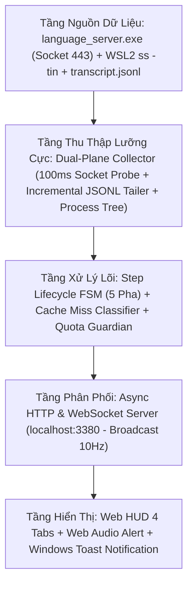
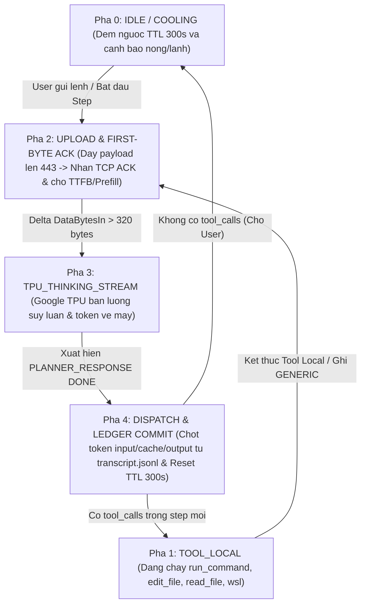

# Bản Thiết Kế Kiến Trúc & Kế Hoạch Triển Khai: Hệ Thống Giám Sát KV Cache, Chu Trình Step & Kiểm Soát Quota Thời Gian Thực (`kv_cache_hud`)

> [!abstract]+ Tóm tắt Mục tiêu Kiến trúc
> Hệ thống **KV Cache & Step Lifecycle HUD** được thiết kế cho môi trường `Windows Host + WSL2` nhằm:
> - Đo lường theo thời gian thực (**10Hz / 100ms**) tiến trình thực thi từng pha của 1 Step Agent: `Tool Local` $\to$ `Pha Gửi & First-Byte ACK` $\to$ `Pha Thinking Stream (TPU)` $\to$ `Pha Đầu ra (run_command, edit_file)`.
> - Đối soát chính xác 100% các chỉ số token (`input_tokens` raw/fresh, `cache_read_tokens`, `output_tokens`) từ phản hồi chuẩn của server Google.
> - Chuyển hóa từ Dashboard thụ động sang **Active Quota & Network Guardian**: phân loại nguyên nhân rớt KV Cache ("cây vàng"), phát hiện tắc nghẽn TCP/Blackhole trước khi hết hạn `TTL 5 phút` (`300s`), cảnh báo điểm hòa vốn và tối ưu giữ kết nối mạng ổn định.

---

## Phần 1. Kiểm toán Hạ tầng Thực tế trên Máy (Ground-Truth Audit & Giải bài toán TLS 1.3)

### 1.1. Thông số Môi trường Đã Xác minh Trên Máy

> [!info]+ Kết quả Khảo sát Thực địa (`d:\01_Workspace\Personal_Dev\esp_nghich`)
> - **Hệ điều hành & Môi trường chạy:** Windows Host kết hợp `WSL2` (`Ubuntu-22.04`, `docker-desktop`).
> - **Runtime khả dụng sẵn:** `Python 3.12.10` và `Node.js v24.18.0` (`go` và `cargo` hiện chưa cài đặt trên máy).
> - **Tiến trình lõi giữ kết nối tới Google Server:** `language_server.exe` (`C:\Users\Cam\AppData\Local\Programs\antigravity\resources\bin\language_server.exe`).
> - **Kết nối TCP/TLS 1.3 đang mở tới Google Edge (cổng `443`):** Thực tế ghi nhận các socket `Established` từ địa chỉ local tới nhiều IP Google Edge khác nhau đồng thời: `172.217.113.4:443`, `172.217.115.4:443`, `172.217.119.4:443` (cùng các dải thuộc hạ tầng Google như `142.250.0.0/15`, `172.253.0.0/16`).
> - **Kho dữ liệu Phiên & Nhật ký Token chuẩn:** `C:\Users\Cam\.gemini\antigravity\brain\<conversation-id>\.system_generated\logs\transcript.jsonl` và thư mục `conversations\`, `annotations\`.

### 1.2. Nguồn Số liệu Token Chuẩn Xác 100% (`Ground-Truth Ledger`)

Ngay khi `language_server.exe` nhận xong luồng phản hồi từ server Google, tiến trình này trích xuất dữ liệu thống kê chuẩn từ gói tin trả về và ghi thành một bản ghi JSON trên một dòng (`type: "PLANNER_RESPONSE"`, `status: "DONE"`) trong `transcript.jsonl`. Các trường số nguyên được ghi nhận trực tiếp trên máy gồm:

- `cache_read_tokens`: Lượng token đọc lại được từ KV Cache đang lưu trên bộ nhớ HBM của cụm Google TPU.
- `input_tokens`: Lượng token **Fresh Input** (token mới chưa khớp prefix trên cache — thành phần tiêu tốn trực tiếp hạn mức quota nạp mới).
- `output_tokens`: Tổng lượng token do model sinh ra trong bước đó (bao gồm phần suy luận nội bộ `thinking`, nội dung trả lời `content` và tham số `tool_calls`).

**Bằng chứng đối chiếu thực tế từ `transcript.jsonl` trên máy hiện tại:**
- Tại `step_index: 7` (chưa có cache trước đó): `input_tokens = 27538`, `cache_read_tokens = 0`, `output_tokens = 2589`.
- Tại `step_index: 11` (cùng model, gọi tiếp trong cửa sổ `< 5 phút`): `cache_read_tokens = 27539`, `input_tokens = 11749`, `output_tokens = 1428`.

Tổng kích thước ngữ cảnh hiện hành ở bước thứ $k$ được tính bằng công thức:

$$N_{\text{context}}(k) = N_{\text{cache\_read}}(k) + N_{\text{fresh\_input}}(k)$$

### 1.3. Phản biện Kỹ thuật về "Monitor Gói Tin Chuẩn" & Giải pháp Kiến trúc Lưỡng cực (`Dual-Plane`)

> [!warning]+ Giới hạn Vật lý của Giao thức TLS 1.3 & Độ trễ Log
> 1. **Giới hạn khi chỉ đọc gói tin mạng thô (Packet Sniffer / WinDivert / Npcap):** Toàn bộ lưu lượng cổng `443` giữa `language_server.exe` và dải IP Google được mã hóa đầu cuối bằng **TLS 1.3** (Forward Secrecy). Bộ bắt gói ngoài card mạng chỉ nhìn thấy ciphertext, không thể giải mã lấy JSON `usageMetadata` nếu không dựng MITM CA Proxy. Việc chèn MITM proxy có nguy cơ xung đột Certificate Pinning hoặc bị tiến trình client từ chối kết nối.
> 2. **Giới hạn khi chỉ đọc file `transcript.jsonl`:** File nhật ký chỉ được ghi xuống đĩa khi `status == "DONE"`. Trong suốt `20s – 200s` khi Google TPU đang Prefill hoặc Thinking/Streaming, `transcript.jsonl` hoàn toàn bất động — HUD sẽ bị "mù" ở các pha trung gian.

Để đạt độ chính xác **100% số token chuẩn** mà vẫn bám sát tiến độ **từng `100ms`** không cần bẻ khóa TLS hay cài driver kernel phức tạp, hệ thống áp dụng **Kiến trúc Lưỡng cực (`Dual-Plane Architecture`)**:

- **Mặt phẳng Dữ liệu Mạng & Tiến trình (`Fast Telemetry Plane — 10Hz`):** Đọc trực tiếp bộ đếm TCP Socket của `language_server.exe` qua Windows Kernel API (`iphlpapi.dll`) và cây tiến trình con cục bộ (`powershell.exe`, `wsl.exe`, trình biên dịch) để bắt chính xác từng mốc: kết thúc lệnh local, thời điểm đẩy byte lên cổng `443`, `First-Byte TCP ACK`, mốc `TTFB` khi byte dữ liệu TLS đầu tiên từ Google quay về, tốc độ luồng Thinking (`KB/s`), độ trễ mạng (`SmoothedRtt`) và gói truyền lại (`PktsRetrans`).
- **Mặt phẳng Đối soát Token Chuẩn (`Ground-Truth Ledger Plane — Event-driven`):** Theo dõi thay đổi file `transcript.jsonl` theo offset tăng dần (`incremental tailing`). Ngay khoảnh khắc bước LLM kết thúc (`DONE`), đối chiếu cặp thời gian đóng pha trên socket với bản ghi `PLANNER_RESPONSE` vừa ghi để chốt sổ chính xác `input_tokens`, `cache_read_tokens`, `output_tokens`, tính tốc độ sinh thực tế (`tok/s`) và reset đồng hồ `TTL 5 phút`.

---

## Phần 2. Kiến trúc Hệ thống 4 Tầng & Máy Trạng Thái Chu Trình 1 Step (`Step Lifecycle FSM`)

### 2.1. Sơ đồ Kiến trúc Tổng thể 4 Tầng



Chi tiết trách nhiệm của 4 tầng xử lý:
- **Tầng Thu Thập (`Collector`):** Chạy 3 luồng thu thập bất đồng bộ độc lập (`SocketProbe`, `TranscriptTailer`, `ProcessWatcher`), chuẩn hóa mọi sự kiện về cùng một đồng hồ đơn điệu (`time.monotonic_ns()`) gắn kèm dấu thời gian UTC.
- **Tầng Xử Lý Lõi (`FSM & Guardian`):** Hợp nhất tín hiệu mạng và log thành trạng thái duy nhất tại mỗi thời điểm, tính toán `P50`, `P95`, `TTFB`, `tok/s`, đếm ngược `TTL 300s`, phân loại nguyên nhân rớt cache và kích hoạt cảnh báo kinh tế học quota.
- **Tầng Phân Phối (`Local Server`):** Giữ vòng đệm lịch sử trong RAM (tối đa 500 bước gần nhất của phiên đang xem để cố định bộ nhớ `< 40MB`), đẩy gói delta trạng thái qua WebSocket mỗi `100ms` tới mọi trình duyệt đang mở.
- **Tầng Hiển Thị & Cảnh báo (`HUD & Notifier`):** Hiển thị đồ thị 40 bước gần nhất, thanh phân rã pha thời gian thực, cảnh báo nổi Windows Toast khi cache sắp nguội hoặc mạng gặp sự cố.

### 2.2. Máy Trạng Thái Hữu Hạn 5 Pha Của 1 Step (`Step Lifecycle FSM`)



Quy tắc chuyển pha và đo lường chính xác tại từng pha:

> [!info]+ Đặc tả Định lượng Từng Pha trong Chu trình 1 Step
> 1. **Pha 0 — `IDLE / COOLING`:**
>    - Tính toán tuổi thọ cache còn lại: `TTL = max(0.0, 300.0 - (t_now - t_last_tpu_done))`.
>    - Ngưỡng trạng thái nhiệt độ Cache:
>      - **Nóng (Warm):** `TTL > 180s` (xanh lá).
>      - **Đang nguội (Cooling):** `60s < TTL <= 180s` (vàng nhạt).
>      - **Nguy kịch (Critical):** `0s < TTL <= 60s` (cam/đỏ nhấp nháy).
>      - **Đã rớt (Evaporated):** `TTL == 0s` (đỏ sẫm — nguy cơ "cây vàng" khi gửi bước kế tiếp).
> 2. **Pha 1 — `TOOL_LOCAL` (`run_command`, `edit_file`, `write_file`, `read_file`):**
>    - Kích hoạt ngay khi bản ghi `PLANNER_RESPONSE` gần nhất chứa mảng `tool_calls` và chưa có bản ghi `GENERIC` tương ứng.
>    - Quét cây tiến trình con của `language_server.exe` (`powershell.exe`, `cmd.exe`, `wsl.exe`, `python.exe`...) để hiển thị tên công cụ đang chiếm dụng thời gian thực thi cục bộ.
> 3. **Pha 2 — `UPLOAD & FIRST-BYTE ACK` (Pha gửi & Chờ TTFB/Prefill):**
>    - **Pha 2a (Upload & TCP First-Byte ACK từ Google Edge):** Kích hoạt khi dòng `GENERIC` (kết quả tool) hoặc `USER_INPUT` xuất hiện, đồng thời tổng lượng gửi $\Delta \text{DataBytesOut}$ trên socket `:443` của `language_server.exe` vượt ngưỡng `> 1024 bytes`. Giám sát `ThruBytesAcked` trên socket đang gửi: khi `ThruBytesAcked` đuổi kịp mốc `DataBytesOut` của payload vừa đẩy, ghi nhận mốc **Google Edge ACK hoàn tất đường lên**.
>    - **Pha 2b (Chờ TTFB / TPU Prefill):** Tính từ lúc gửi xong request đến khi có đợt `DataBytesIn` hợp lệ đầu tiên từ Google trả về ($\Delta \text{DataBytesIn} > 320\text{ bytes}$ trong một cửa sổ polling `100ms`, nhằm lọc bỏ các gói ACK rỗng `0 byte` hoặc gói điều khiển HTTP/2 `PING` / `WINDOW_UPDATE` kích thước nhỏ `<= 64 bytes`). Khoảng thời gian Pha 2 chính là **`TTFB / Prefill Latency`**.
> 4. **Pha 3 — `TPU_THINKING_STREAM` (TPU bắn luồng suy luận về máy):**
>    - Tính từ mốc vượt `TTFB` cho đến khi `transcript.jsonl` hoàn tất ghi dòng `PLANNER_RESPONSE` mới.
>    - Đo tốc độ dòng dữ liệu mã hóa đổ về mỗi giây: $\text{Throughput}_{\text{in}} = \Delta \text{DataBytesIn} / \Delta t$ (`KB/s`) để phân biệt luồng suy luận đang chảy đều với hiện tượng đứt kết nối ngầm.
>    - Nếu tổng thời gian (`Pha 2 + Pha 3`) vượt quá `90s`, kích hoạt ngay **Banner Cảnh báo Đỏ** trên đầu HUD tương tự cơ chế giám sát suy luận lâu.
> 5. **Pha 4 — `DISPATCH & LEDGER COMMIT` (Pha đầu ra & Chốt sổ Token):**
>    - Khi `transcript.jsonl` flush dòng `PLANNER_RESPONSE` (`status: "DONE"`), trích xuất tức thì `input_tokens`, `cache_read_tokens`, `output_tokens`, tên model và `tool_calls`.
>    - Tính tốc độ sinh token thực tế của bước (nếu thời gian Pha 3 hợp lệ $> 0.2\text{s}$):
>
> $$v_{\text{gen}} = \frac{N_{\text{output\_tokens}}}{T_{\text{thinking\_stream}}}$$
>
>    - Reset đồng hồ `TTL` về `300.0s`, cập nhật tổng lũy kế phiên, và chuyển tiếp sang **Pha 1** (nếu agent phát lệnh `run_command` / `edit_file` tiếp theo) hoặc về **Pha 0** (nếu đã trả lời xong cho người dùng).

---

## Phần 3. Kỹ thuật Đọc Socket Kernel Chính xác Không Cần Quyền Cao / Không Cài Driver (`iphlpapi.dll` & WSL2 Bridge)

### 3.1. Cơ chế Truy vấn Socket Windows Qua `ctypes` + `iphlpapi.dll`

Sử dụng trực tiếp thư viện chuẩn `ctypes` trong `Python 3.12.10` gọi API tầng User-Mode của Windows (`iphlpapi.dll`), không phụ thuộc WinPcap/Npcap và không can thiệp vào luồng truyền dữ liệu của `language_server.exe`:

1. **Liệt kê Socket Theo PID (`GetExtendedTcpTable`):**
   - Gọi `GetExtendedTcpTable` cho cả `AF_INET` (IPv4) và `AF_INET6` (IPv6) với cờ `TCP_TABLE_OWNER_PID_CONNECTIONS`.
   - Lọc các kết nối có `dwOwningPid == PID(language_server.exe)`, `dwState == MIB_TCP_STATE_ESTAB` (và ghi nhận các socket đang kẹt ở `SYN_SENT` / `CLOSE_WAIT`), có `RemotePort == 443` và `RemoteAddr` thuộc dải IP Google (`172.217.0.0/16`, `142.250.0.0/15`, `172.253.0.0/16`, `74.125.0.0/16`, `216.58.192.0/19`, hoặc đối chiếu PTR/WHOIS cục bộ).
2. **Đọc Bộ Đếm Chuyên Sâu (`SetPerTcpConnectionEStats` & `GetPerTcpConnectionEStats`):**
   - Với IPv4 dùng `SetPerTcpConnectionEStats` / `GetPerTcpConnectionEStats`; với IPv6 dùng `SetPerTcp6ConnectionEStats` / `GetPerTcp6ConnectionEStats`.
   - Cấu trúc `TcpConnectionEstatsData` (`TCP_ESTATS_DATA_ROD_v0`): thu thập `DataBytesOut`, `DataBytesIn`, `ThruBytesAcked`, `ThruBytesReceived`.
   - Cấu trúc `TcpConnectionEstatsPath` (`TCP_ESTATS_PATH_ROD_v0`): thu thập `SmoothedRtt` (ms), `RttVar`, `FastRetran`, `PktsRetrans`, `BytesRetrans` (sẽ đối chiếu chính xác byte-offset với header `tcpestats.h` của Windows SDK trong giai đoạn cài đặt).

### 3.2. Chiến lược Fallback Đa Tầng Khi Chạy Quyền User Thường

⚠️ **Lưu ý kỹ thuật về quyền truy cập trên Windows:** Theo thiết kế bảo mật của Windows, hàm `SetPerTcpConnectionEStats` (bước bật cờ thu thập thống kê trên socket) yêu cầu quyền `Administrator` và sẽ trả về mã lỗi `ERROR_ACCESS_DENIED (5)` khi tiến trình giám sát chạy dưới quyền User thông thường.

Để hệ thống vẫn vận hành mượt mà trong mọi ngữ cảnh phân quyền, tầng `net_probe` áp dụng **cơ chế tự động hạ cấp an toàn (Graceful 3-Tier Fallback)**:

> [!tip]+ 3 Tầng Thu thập Tín hiệu Mạng Tự động Thích ứng
> - **Tầng 1 — Full Kernel EStats Mode (Khi chạy với quyền Administrator):** Mở khóa toàn bộ `TCP_ESTATS_DATA` và `TCP_ESTATS_PATH`. Đọc chính xác từng byte vào/ra, `ThruBytesAcked`, `SmoothedRtt` và `PktsRetrans` trên từng kết nối `:443` với chu kỳ `100ms`.
> - **Tầng 2 — Standard User Telemetry Mode (Khi chạy quyền User thường — không cần UAC):**
>   - Tiếp tục dùng `GetExtendedTcpTable` (API này luôn cho phép quyền User thường đọc) để theo dõi danh sách IP Google Edge đang mở, phát hiện ngay việc đổi IP đích (`RemoteAddr` thay đổi) hoặc đứt/rớt socket sang `CLOSE_WAIT` / `SYN_SENT`.
>   - Kết hợp `GetProcessIoCounters` (`kernel32.dll`) trên PID của `language_server.exe` và theo dõi `mtime` / kích thước tăng thêm của các file sidecar (`annotations`, `conversations`, `transcript.jsonl`) để suy ra hoạt động Upload/Stream và tách pha gần đúng.
> - **Tầng 3 — WSL2 Native Bridge (`net_probe_wsl.py`):** Khi theo dõi các tác vụ/agent chạy trong `WSL2 Ubuntu-22.04`, chạy lệnh `wsl -d Ubuntu-22.04 -- ss -tin -p` định kỳ và đọc `/proc/net/tcp`. Trên Linux/WSL2, tiện ích `ss -tin` đọc được trực tiếp thông số kernel `rtt`, `bytes_acked`, `bytes_received`, `retrans` của các socket thuộc user **mà không cần quyền `root`**.

---

## Phần 4. Động cơ Tối ưu Hóa Quota & Kiểm soát Mạng Chủ động

Hệ thống không dừng lại ở việc vẽ đồ thị (như bản HUD cơ bản), mà tích hợp 4 bộ máy phân tích và phòng vệ nhằm triệt tiêu "cây vàng":

### 4.1. Bộ Phân Loại Nguyên Nhân Rớt Cache (`Cache Miss Root-Cause Classifier`)

Mỗi khi bước thứ $k$ hoàn tất mà xuất hiện dấu hiệu rớt KV Cache ("Cây vàng"), được định nghĩa định lượng khi ngữ cảnh trước đó đã đủ lớn ($N_{\text{context}}(k-1) > 10\,000$ token) nhưng tỉ lệ tái sử dụng sụt giảm nghiêm trọng:

$$N_{\text{cache\_read}}(k) < 0.5 \times N_{\text{context}}(k-1)$$

Hệ thống tự động đối chiếu dữ liệu từ Socket Probe và `transcript.jsonl` để gắn nhãn **1 trong 4 nguyên nhân gốc**:

> [!abstract]+ Ma trận Phân loại 4 Nguyên nhân Cây vàng
> 1. `TTL_TIMEOUT`: Khoảng thời gian giữa hai lần chạm server liên tiếp $(t_{\text{gửi}}(k) - t_{\text{xong}}(k-1)) \ge 300\text{s}$. Bộ nhớ HBM trên TPU đã tự động thu hồi cache hết hạn.
> 2. `MODEL_CHANGE`: Có sự kiện `<USER_SETTINGS_CHANGE>` thay đổi model giữa bước $k-1$ và bước $k$ (đã xác nhận thực tế qua `transcript.jsonl`: đổi model làm `cache_read_tokens` rớt về `0`).
> 3. `SOCKET_ENDPOINT_SWITCH`: Khoảng nghỉ $< 300\text{s}$ và cùng model, nhưng cặp `(LocalPort, RemoteIP:443)` đang phục vụ phiên bị thay thế bởi một IP Google Edge khác hoặc tạo kết nối TCP mới sau khi socket cũ bị `RST`/`CLOSE_WAIT`, dẫn tới request bị định tuyến sang cụm TPU không có sẵn KV tensor.
> 4. `CONTEXT_TRUNCATION_OR_RESET`: Thời gian $< 300\text{s}$, cùng model và giữ nguyên socket cũ, nhưng prefix đầu chuỗi bị thay đổi (nén context, cắt bớt lịch sử hoặc sửa system prompt).

### 4.2. Trình Tối Ưu Đường Truyền Mạng & Phân Biệt Treo Mạng (`Network Stability Tuner`)

- **Kiểm tra & Tối ưu TCP Keep-Alive:**
  - Bộ định tuyến gia đình và bộ NAT ảo của `WSL2` thường xóa bảng ánh xạ cổng TCP nếu kết nối im lặng quá `60s – 120s`. Trong khi đó, thông số mặc định `KeepAliveTime` của Windows lên tới `7200000ms` (2 giờ), dẫn đến kết nối bị ngắt âm thầm ngay giữa lúc TPU đang `thinking` lâu (`> 90s`).
  - Hệ thống cung cấp module kiểm tra giá trị Registry `HKLM\SYSTEM\CurrentControlSet\Services\Tcpip\Parameters\KeepAliveTime` và tạo sẵn **script PowerShell/Bash có xác nhận 1-click của người dùng** (kèm script khôi phục mặc định) để hạ `KeepAliveTime` xuống `15000ms` (`15s`) và `tcp_keepalive_time = 15` trong WSL2.
- **Bộ Phân Biệt `Network Blackhole` vs `True TPU Deep Thinking`:**
  Khi tiến trình đang kẹt ở Pha 2 hoặc Pha 3 quá `45s`, Guardian đánh giá sức khỏe socket theo 2 nhánh:
  - **Nhánh Nghẽn/Đứt Mạng Cục Bộ (`Network Blackhole`):** `PktsRetrans` tăng liên tục, `SmoothedRtt` vọt cao bất thường hoặc socket biến mất / kẹt ở `SYN_SENT` / `CLOSE_WAIT`. Cảnh báo đỏ ngay: *"Phát hiện đứt/nghẽn đường truyền TCP — Nên hủy và gửi lại ngay trước khi hết TTL 5 phút!"*.
  - **Nhánh Suy Luận Sâu Thực Sự (`True TPU Thinking`):** `PktsRetrans == 0`, `SmoothedRtt` ổn định (`< 80ms`), kết nối `ESTABLISHED` nguyên vẹn (và có `DataBytesIn` nhích nhẹ theo heartbeat/chunk). Thông báo xanh trấn an: *"Đường truyền sạch — TPU đang suy luận thật, tuyệt đối KHÔNG bấm Cancel tránh mất oan token đã tính"*.

### 4.3. Cảnh Báo Kinh Tế Học Quota & Điểm Hòa Vốn (`Break-Even TTL Watchdog`)

Thiệt hại trực tiếp tính bằng Fresh Token nếu để bộ đếm TTL chạm `00:00` bằng chính kích thước ngữ cảnh đang giữ:

$$\Delta Q_{\text{loss}}(k) = N_{\text{context}}(k)$$

Hệ thống kích hoạt chuỗi cảnh báo đa kênh (Audio Web API + Windows Toast Notification):
- **Mốc `90s` còn lại (Cảnh báo Vàng):** Chỉ kích hoạt khi $N_{\text{context}} \ge 50\,000$ token — nhắc nhở người dùng nếu còn thao tác tiếp thì chuẩn bị gửi trong vòng 1.5 phút tới.
- **Mốc `30s` còn lại (Cảnh báo Cam):** Âm báo nhẹ + thông báo nổi Windows báo sắp hết hạn giữ KV Cache.
- **Mốc `0s` (Báo động Đỏ — Cache Evaporated):** Hiển thị thanh cảnh báo khóa đỏ: *"KV Cache X nghìn token đã hết hạn 5 phút. Gửi tiếp tin nhắn ngắn vào phiên này sẽ đốt ngay X nghìn Fresh Input (Cây vàng)"*. Kèm nút **1-Click Copy Handoff Summary**: bộ lọc tự động đọc `transcript.jsonl` rút trích mục tiêu ban đầu, các file vừa sửa và bước cuối còn dở thành một đoạn tóm tắt gọn (`~1.5k – 3k` token) để mở phiên mới hoặc chạy `/compact`, cắt giảm `> 95%` lượng Fresh Input phải nạp lại.

### 4.4. Kiểm Toán Viên Phình Ngữ Cảnh (`Step Bloat Auditor`)

Ở mỗi bước hoàn tất, hệ thống tính độ phình ròng của ngữ cảnh:

$$\Delta N_{\text{bloat}}(k) = N_{\text{context}}(k) - N_{\text{context}}(k-1)$$

Nếu một lần gọi `run_command`, `read_file` hoặc `search` làm ngữ cảnh phình thêm `> 15 000` token chỉ trong 1 bước, bước đó bị gắn cờ `[BLOAT]` trên biểu đồ và trong nhật ký chi tiết để người dùng nhận diện ngay lệnh terminal nào đang bơm rác log vào bộ nhớ đệm.

---

## Phần 5. Thiết Kế Giao Diện Web HUD (`localhost:3380`) — 4 Tab Chuyên Sâu

Giao diện sử dụng phong cách Dark-Mode độ tương phản cao, cập nhật thời gian thực qua WebSocket `10Hz` mà không giật trang:

> [!info]+ Cấu trúc Header & Thanh Tiến Trình Trực Tiếp (Luôn ghim trên cùng)
> - **Thanh điều khiển trên cùng:** Nhãn trạng thái `LIVE` (xanh lá) / `RECONNECTING` (đỏ), bộ chuyển đổi môi trường `Windows Host` / `WSL2`, dropdown chọn phiên làm việc kèm nút bật/tắt `Tự bám theo Tab đang chạy (Auto-Follow)`, nút `Ghim`, `Đổi tên gợi nhớ`, `Xuất JSON`, `Copy Handoff` và nút `Chuông: Bật/Tắt`.
> - **Dynamic Phase Progress Banner:** Thanh trạng thái 4 chặng chạy mượt theo thời gian thực (`1. Tool Local` $\to$ `2. Pha gửi & ACK` $\to$ `3. TPU Thinking` $\to$ `4. Đầu ra & Ghi sổ`), hiển thị bộ đếm giây `0.1s`, số byte đã gửi/nhận, IP Edge đang bám và tự chuyển sang khung đỏ báo động khi thời gian chờ vượt `90s` hoặc phát hiện lỗi TCP.

Chi tiết nội dung của **4 Tab chức năng**:

1. **Tab 1 — `Tổng quan`:**
   - **Thẻ `% Cache Read vs % Fresh Input`:** Hiển thị tỉ lệ % tổng lũy kế và số token tuyệt đối (`Cache` màu xanh vs `Fresh` màu đỏ), tên model đang chạy (ví dụ `G4 Carbon`), tỉ lệ bước cuối cùng, tổng số bước LLM.
   - **Thẻ `Tuổi thọ Cache (TTL 5p)`:** Đồng hồ đếm ngược `MM:SS` lớn, thanh tiến trình đổi màu theo nhiệt độ (`Nóng` $\to$ `Đang nguội` $\to$ `Nguy kịch` $\to$ `Đã rớt`), tổng `Ngữ cảnh` hiện hành và bộ đếm `Rớt Cache: N lần` kèm nhãn nguyên nhân của lần rớt gần nhất.
   - **Thẻ `Hồ sơ Độ trễ Agent (Latency Breakdown)`:** Các chỉ số `Bước cuối`, `Trung vị (P50)`, `Đỉnh P95`, `TTFB TB`, tốc độ sinh `tok/s`; thanh ngang phân rã 4 màu (`TTFB/Prefill`, `Suy luận/Gen`, `Monitor`, `Tool Local`) và dòng so sánh thời gian/hiệu suất giữa `Cache HIT` vs `Cache MISS`.
   - **Biểu đồ `40 bước gần nhất`:** Cho phép chuyển chế độ hiển thị giữa `% Tỉ lệ` và `Số Token tuyệt đối`. Cột xanh lá = `Cache Read`, chóp đỏ = `Fresh Input` bình thường, **Cột Vàng = Bước bị rớt KV Cache ("Cây vàng")**, vạch ngăn `||` màu xám = khoảng nghỉ dài giữa các cụm thao tác. Rê chuột vào bất kỳ cột nào để xem tooltip chi tiết (`step_index`, thời gian, số token, nguyên nhân nếu rớt cache, cảnh báo `[BLOAT]`).
2. **Tab 2 — `Độ trễ & Monitor Mạng`:**
   - Biểu đồ đường thời gian thực `Bytes Out / Bytes In` (`100ms` tick) và đồ thị `Smoothed RTT (ms)` + `TCP Retransmissions`.
   - Danh sách các socket cổng `443` của `language_server.exe` (Local Port, Remote IP Google Edge, Trạng thái TCP, Byte gửi/nhận lũy kế, đánh dấu socket đang active).
   - Bảng trạng thái cấu hình `TCP Keep-Alive` của Windows & WSL2 kèm nút xuất/chạy script tối ưu an toàn (có tùy chọn khôi phục).
3. **Tab 3 — `Từng bước (Step Inspector)`:**
   - Danh sách toàn bộ các bước `#1 -> #N` hỗ trợ lọc nhanh theo: `Tất cả`, `Chỉ Cây vàng (Cache MISS)`, `Chỉ bước Bloat (>15k tok)`, `Suy luận lâu (>90s)`.
   - Mỗi dòng hiển thị đủ: thời gian từng pha (`Tool Local`, `Upload/TTFB`, `Thinking`, `Output`), loại Tool đã gọi (`run_command`, `edit_file`, `read_file`...), số lượng chính xác `Fresh Input`, `Cache Read`, `Output`, tốc độ `tok/s` và nhãn nguyên nhân rớt cache.
4. **Tab 4 — `Đa phiên & Cắt lỗ Quota`:**
   - Bảng tổng hợp các phiên trong `C:\Users\Cam\.gemini\antigravity\brain\` theo ngày: tổng `Fresh Input` đã tiêu tốn, tổng `Cache Read` tiết kiệm được, số lần rớt cache của từng phiên.
   - Thống kê tỷ trọng nguyên nhân gây rớt cache (`TTL_TIMEOUT` vs `MODEL_CHANGE` vs `SOCKET_ENDPOINT_SWITCH`).
   - Trình tạo **Smart Handoff Prompt** cho phép chọn bất kỳ phiên nào đã nguội để xuất nhanh bản tóm tắt sang clipboard.

---

## Phần 6. Kiến Trúc Mã Nguồn & Lộ Trình Triển Khai 6 Giai Đoạn (Dành cho `/goal`)

### 6.1. Cấu trúc Thư mục Dự án Độc lập

Toàn bộ mã nguồn được đặt gọn trong `d:\01_Workspace\Personal_Dev\esp_nghich\kv_cache_hud\` (tách biệt hoàn toàn với `pro_1`). Sử dụng `Python 3.12` (chạy trên thư viện chuẩn + `aiohttp` hoặc module `asyncio` + WebSocket thuần nhẹ để không phụ thuộc build tool phức tạp) và Frontend `Vanilla HTML5 / CSS3 / ES6 Modules`:

```text
d:\01_Workspace\Personal_Dev\esp_nghich\kv_cache_hud\
├── PLAN_KV_CACHE_HUD.md
├── run_hud.bat
├── requirements.txt
├── kv_cache_hud\
│   ├── __init__.py
│   ├── __main__.py
│   ├── config.py
│   ├── transcript_watcher.py
│   ├── net_probe_win.py
│   ├── net_probe_wsl.py
│   ├── process_watcher.py
│   ├── step_fsm.py
│   ├── quota_guardian.py
│   ├── handoff_builder.py
│   ├── network_tuner.py
│   └── server.py
├── static\
│   ├── index.html
│   ├── styles.css
│   ├── app.js
│   ├── charts.js
│   └── audio_alert.js
└── tests\
    ├── test_transcript_watcher.py
    ├── test_step_fsm.py
    ├── test_quota_guardian.py
    └── test_net_probe_win.py
```

### 6.2. Lộ trình Triển khai 6 Giai đoạn & Tiêu chí Kiểm thử

> [!info]+ Giai đoạn 1: Bộ Đọc Nhật Ký Token Chuẩn (`transcript_watcher.py`)
> - **Công việc:** Quét toàn bộ thư mục con trong `brain/`, tự động nhận diện phiên có thời gian cập nhật mới nhất (Auto-Follow) và hỗ trợ ghim phiên cố định. Cài đặt Incremental JSONL Tailer đọc theo byte offset (chống đọc lại toàn bộ file lớn), trích xuất chính xác `input_tokens`, `cache_read_tokens`, `output_tokens`, model hiện hành, danh sách `tool_calls`, phát hiện sự kiện `<USER_SETTINGS_CHANGE>` và đánh dấu bước Cây vàng / `[BLOAT]`.
> - **Tiêu chí Pass:** `pytest` vượt qua toàn bộ ca test trên dữ liệu giả lập lẫn đọc đối chiếu trực tiếp file `transcript.jsonl` thật trên máy (khớp 100% giá trị Step 7 và Step 11).

> [!info]+ Giai đoạn 2: Bộ Dò Socket Kernel & Tiến Trình (`net_probe_win.py`, `net_probe_wsl.py`, `process_watcher.py`)
> - **Công việc:** Viết binding `ctypes` gọi `iphlpapi.dll` (`GetExtendedTcpTable`, `SetPerTcpConnectionEStats`, `GetPerTcpConnectionEStats` cho IPv4/IPv6), tích hợp cơ chế Fallback 3 tầng khi không chạy quyền Admin, quét tiến trình con (`powershell.exe`, `wsl.exe`, compiler) dưới PID của `language_server.exe`, và module cầu nối đọc `ss -tin` trong WSL2.
> - **Tiêu chí Pass:** Chạy script test trực tiếp trên PID thực tế của `language_server.exe` đang mở: liệt kê chính xác các IP Google cổng `443` đang `ESTABLISHED`, không crash và tự động chuyển tầng Fallback sạch sẽ khi test dưới quyền User thường.

> [!info]+ Giai đoạn 3: Máy Trạng Thái Chu Trình 5 Pha (`step_fsm.py`)
> - **Công việc:** Hợp nhất luồng sự kiện từ Giai đoạn 1 và Giai đoạn 2 với vòng lặp `100ms`, tách chính xác `Pha 0` đến `Pha 4`, lọc nhiễu gói HTTP/2 `PING` khỏi mốc `TTFB`, tính toán `P50`, `P95`, `TTFB TB`, `tok/s`, so sánh hiệu suất `Cache HIT` vs `Cache MISS`, và quản lý bộ đếm ngược `TTL 300s`.
> - **Tiêu chí Pass:** Unit test mô phỏng đầy đủ kịch bản `Tool Local -> Upload ACK -> TTFB -> Thinking Stream -> Dispatch -> Cache MISS` khớp đúng chuyển trạng thái và sai số thời gian `< 150ms`.

> [!info]+ Giai đoạn 4: Động cơ Bảo Vệ Quota & Tối Ưu Mạng (`quota_guardian.py`, `handoff_builder.py`, `network_tuner.py`)
> - **Công việc:** Cài đặt bộ phân loại 4 nguyên nhân gây Cây vàng, thuật toán phát hiện `Network Blackhole` vs `True TPU Thinking`, cảnh báo đa mốc `90s / 30s / 0s` qua Windows Toast (PowerShell/WinRT nhẹ không cần thư viện nặng lỗi thời), trình sinh `Smart Handoff Summary`, và bộ kiểm tra/sinh script chỉnh `TCP Keep-Alive`.
> - **Tiêu chí Pass:** Test kịch bản `TTL` về `0s` sinh được Handoff Summary `< 3000` token chứa đủ ngữ cảnh trọng tâm; phân loại đúng cả 4 nhãn nguyên nhân rớt cache; script cấu hình mạng chạy ở chế độ `--dry-run` xuất đúng lệnh và có lệnh hoàn tác.

> [!info]+ Giai đoạn 5: WebSocket Server & Giao Diện HUD 4 Tab (`server.py` + `static/*`)
> - **Công việc:** Dựng máy chủ HTTP + WebSocket bất đồng bộ phục vụ giao diện trên `localhost:3380`, API xuất JSON phiên, API đổi tên/ghim tab, phát sóng state mỗi `100ms` khi có thay đổi (hoặc `1Hz` khi đang đếm ngược TTL để tiết kiệm CPU), hoàn thiện toàn bộ 4 Tab UI, biểu đồ Canvas/SVG 40 cột sắc nét và Web Audio Alert có nút tắt/bật.
> - **Tiêu chí Pass:** Mở trình duyệt tại `http://localhost:3380` hiển thị `LIVE`, chuyển mượt qua lại 4 Tab, nút `Xuất JSON` và `Copy Handoff` hoạt động, không báo lỗi Console JS.

> [!info]+ Giai đoạn 6: Kiểm Thử Tích Hợp & Đo Hiệu Năng Vận Hành Ngầm
> - **Công việc:** Chạy hệ thống song song trong lúc Agent thực hiện thao tác thật (gồm cả `run_command` và suy luận LLM), đối chiếu từng con số hiển thị trên HUD với `transcript.jsonl`, đo mức chiếm dụng CPU và RAM liên tục, hoàn thiện `run_hud.bat` và tài liệu sử dụng ngắn gọn.
> - **Tiêu chí Pass:** Số liệu token trên HUD khớp tuyệt đối với `transcript.jsonl`, CPU trung bình `< 1.5%`, bộ nhớ RAM ổn định `< 50MB`, chạy ổn định khi mất/đổi kết nối hoặc khi khởi động lại `language_server.exe`.

---

## Phần 7. Các Quyết Định Thiết Kế Đã Chốt Duyệt

Ba lựa chọn kiến trúc và vận hành đã được thống nhất triển khai:

1. **Cổng Web HUD mặc định:** `http://127.0.0.1:3380` (tự động lùi tịnh tiến sang dải `3381..3390` nếu cổng `3380` đang có tiến trình khác sử dụng).
2. **Chế độ Phân quyền Thu thập Socket:** Sử dụng chung một bộ mã nguồn tự nhận diện quyền hạn (`Full Kernel EStats` khi `EnableCollection == 1` qua `SetPerTcpConnectionEStats`, tự hạ tầng sang `Standard User Telemetry` dùng `GetExtendedTcpTable` + `GetProcessIoCounters` + WSL2 `ss -tin` khi `ERROR_ACCESS_DENIED`), đóng gói sẵn cả 2 file khởi chạy `run_hud.bat` (User thường) và `run_hud_admin.bat` (nâng quyền UAC Admin), kèm huy hiệu hiển thị rõ chế độ đang chạy trên Header HUD.
3. **Hai Công tắc Bảo vệ Minh bạch & Hợp chuẩn trên Giao diện HUD:**
   - **Công tắc 1 — Tối ưu OS `TCP Keep-Alive` (`15s` vs Mặc định `2 giờ`):** Đọc trực tiếp giá trị thực tế từ Windows Registry (`HKLM\SYSTEM\CurrentControlSet\Services\Tcpip\Parameters\KeepAliveTime`) và `sysctl net.ipv4.tcp_keepalive_time` của WSL2 để hiển thị minh bạch trên UI; cung cấp nút **Bật Tối Ưu (`15000ms`)** / **Khôi Phục Mặc Định (`7200000ms`)** có xác nhận rõ ràng của người dùng (hoặc hiển thị lệnh PowerShell copy/nâng quyền nếu đang chạy ở User thường).
   - **Công tắc 2 — Tự động Kích hoạt Cảnh báo Bảo vệ Quota theo Ngưỡng Token (`Auto-Guard Threshold`, mặc định `50,000` token):** Có nút Bật/Tắt tay, ô chỉnh ngưỡng token, đèn báo trạng thái `GUARD ACTIVE` / `STANDBY`, và nút **Test Chuông & Thông Báo** để kiểm tra trực tiếp âm thanh Web Audio + Windows Toast Notification.
